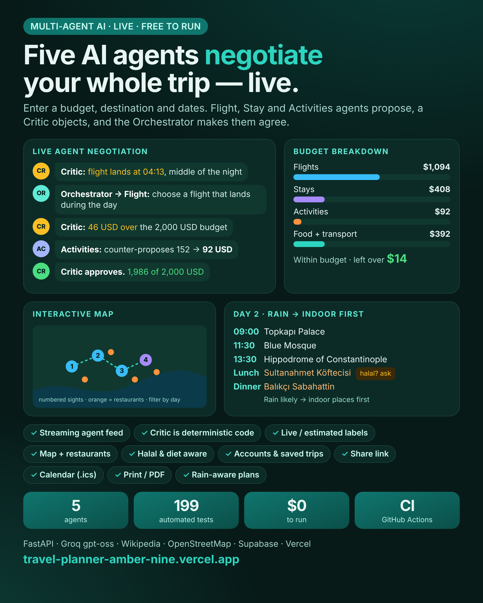
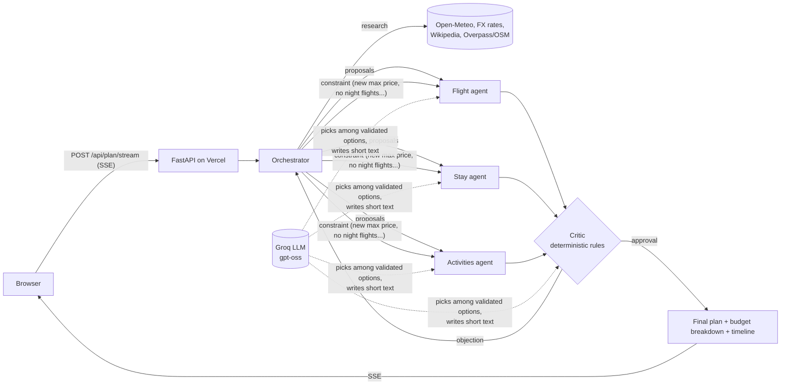
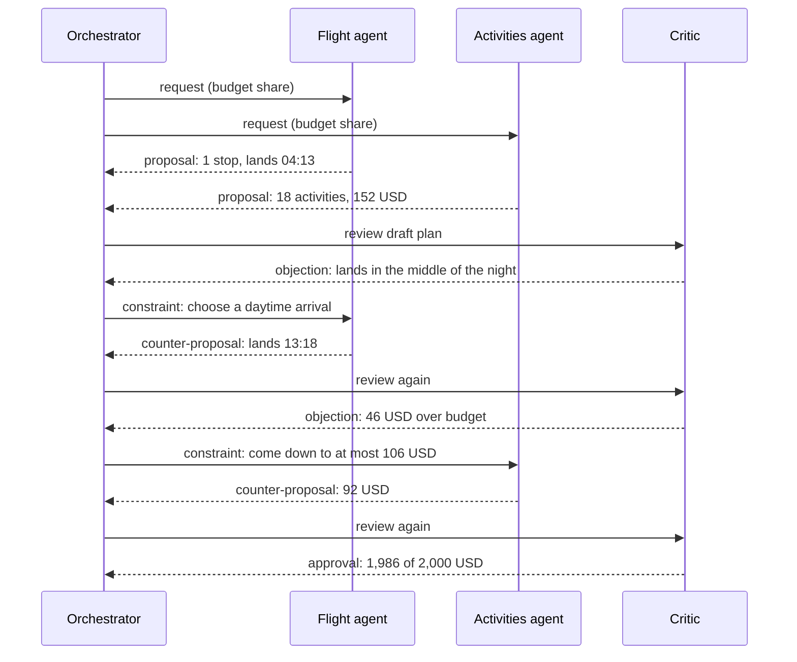
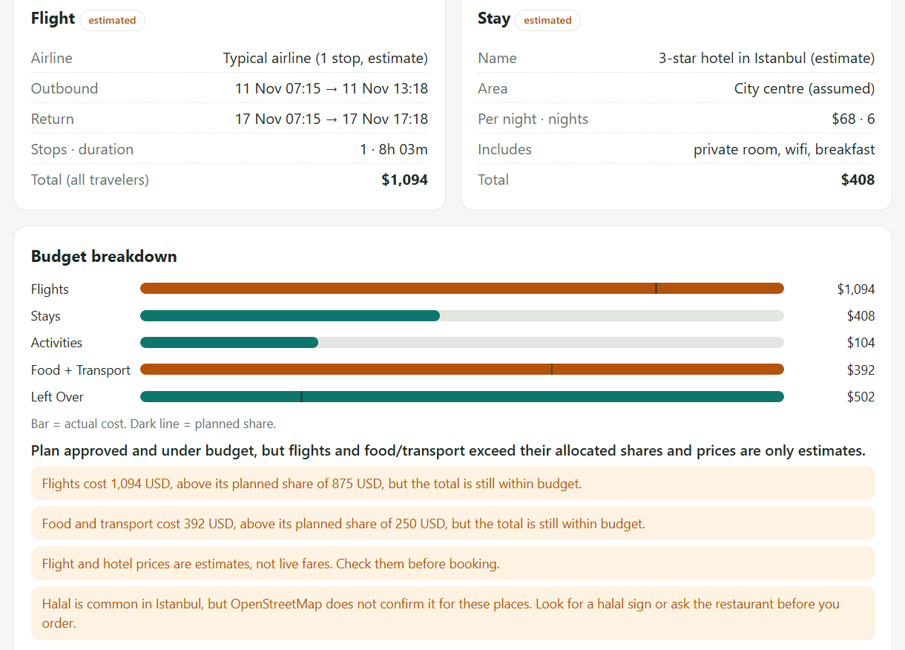
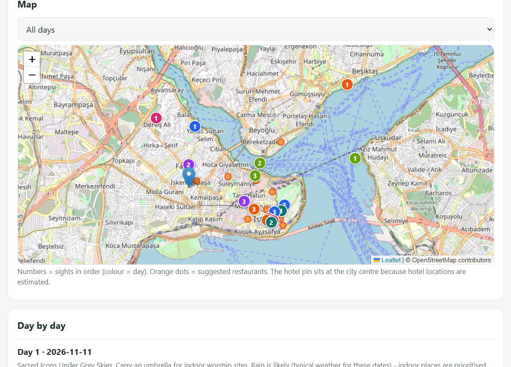

<div align="center">

# ✈️ AI Travel Planner

### Five AI agents plan your whole trip together and **negotiate live** until it fits your budget.

[](https://github.com/muhammadhunzla971-sys/travel-planner/actions/workflows/ci.yml)


**[🚀 Live demo](https://travel-planner-amber-nine.vercel.app/)** &nbsp;·&nbsp; [How it works](#how-it-works) &nbsp;·&nbsp; [Run locally](#run-locally) &nbsp;·&nbsp; [API](#api-reference) &nbsp;·&nbsp; [Deploy free](#deploy-free)



</div>

---

## Table of contents
1. [What it does](#what-it-does)
2. [Features](#features)
3. [How it works](#how-it-works)
4. [The agents](#the-agents)
5. [Design decisions](#design-decisions)
6. [Data sources](#data-sources)
7. [Reliability and security](#reliability-and-security)
8. [Tech stack](#tech-stack)
9. [Project structure](#project-structure)
10. [API reference](#api-reference)
11. [Configuration](#configuration)
12. [Run locally](#run-locally)
13. [Tests and CI](#tests-and-ci)
14. [Deploy free](#deploy-free)
15. [Demo script](#demo-script)
16. [Screenshots](#screenshots)
17. [Known limits](#known-limits)
18. [Roadmap](#roadmap)
19. [Skills demonstrated](#skills-demonstrated)
20. [Credits and data licences](#credits-and-data-licences)
21. [Author](#author)

## What it does
A traveller enters a **budget, destination and dates** (plus optional style, pace, interests and dietary needs).
A **Flight agent**, a **Stay agent** and an **Activities agent** each propose their part of the trip inside their share
of the budget. A **Critic** inspects the combined plan and objects (a 04:13 arrival, overlapping activities, going over
budget). The **Orchestrator** turns every objection into a constraint, sends it back to the right agent, and repeats until the
plan is approved (max 4 rounds). The whole conversation streams to the browser in real time, so you can watch the agents
argue.

The result is a complete trip: flight, hotel, a day-by-day plan with timings, lunch and dinner suggestions, a map, and a
budget breakdown that compares each agent's planned share with what it actually cost.

> **Real run (Istanbul, 2 travellers, 2,000 USD, halal):** the Critic rejected a flight landing at 04:13, then
> rejected the plan for being 46 USD over budget; the Activities agent cut its cost from 152 to 92 USD and the plan was
> approved at 1,986 USD in 2 rounds.

## Features
| Area | What you get |
|---|---|
| **Multi-agent negotiation** | Flight, Stay, Activities, Critic and Orchestrator exchange typed messages (`request`, `proposal`, `counter_proposal`, `constraint`, `approval`); every step is visible live over Server-Sent Events |
| **Deterministic Critic** | Budget, night arrivals, overlaps and time windows are checked by plain code, so an LLM can never approve a bad plan |
| **Fair budget squeezing** | When over budget, activities give way first, then stay and flight share the rest by weight; nobody goes below their cheapest valid option |
| **Honest data labels** | Every number is tagged `live` or `estimated`; flights and hotels have no free live price API, so they are clearly estimates |
| **Live attractions** | Wikipedia: multi-point geosearch, page-view ranking, filters for events, neighbourhoods and history pages |
| **Weather-aware days** | Rain moves indoor places first; timings follow the real arrival and departure times of the chosen flight |
| **Interactive map** | Leaflet + OpenStreetMap: numbered sights per day, restaurant dots, day filter |
| **Restaurants and meals** | Lunch and dinner near each day's sights (Overpass / OpenStreetMap); two servers are queried in parallel for reliability |
| **Dietary needs** | Halal, vegetarian, vegan, kosher, gluten-free: confirmed places rank first, and when OpenStreetMap cannot confirm a diet the app says so instead of guessing |
| **Accounts and saved trips** | Sign up, save, reopen and delete trips (Supabase Auth + Postgres with row-level security) |
| **Share and export** | Shareable link (the trip is packed into the URL, no server storage), calendar export (`.ics`), print / save as PDF, recent trips |
| **Resilient by design** | If the LLM or any data provider fails, rule-based fallbacks keep the planner working |
| **Quality** | 199 automated tests (no network, no LLM needed), `ruff` linting, GitHub Actions CI |

## How it works



### One negotiation, step by step


## The agents
| Agent | Responsibility | How it decides |
|---|---|---|
| **Orchestrator** | Research, budget allocation, collects proposals, runs the negotiation (max 4 rounds, 45 s time budget), builds the final result | Pure code; asks the LLM only for the human-readable summary |
| **Flight agent** | Picks a flight option (direct / 1 stop / budget late) | Filters by constraints and price cap, rule-based ranking; LLM may choose between options that already passed |
| **Stay agent** | Picks a hotel tier (hostel to 4-star) for the nights needed | Respects price cap and minimum stars; LLM may choose among validated options |
| **Activities agent** | Builds the day-by-day schedule | Rule-based: usable hours from flight times, pace (2 / 3 / 4 places per day), rain, interests, nearby places grouped, entry fees capped; LLM only adds a theme and a tip per day |
| **Critic** | Reviews the combined plan | Deterministic checks (below); LLM only turns the findings into a readable verdict |

**What the Critic checks**

| Check | Type | Meaning |
|---|---|---|
| `infeasible` | blocking | Even the cheapest valid plan cannot fit the budget |
| `over_budget` | blocking | Total cost is above the budget |
| `late_arrival` | blocking | The flight lands in the middle of the night |
| `overlap` | blocking | Two activities overlap in time |
| `outside_window` | blocking | An activity starts before arrival or runs past the departure window |
| under-spend, flight-heavy share | warning | Shown to the traveller, does not block approval |

## Design decisions
- **The LLM never has the last word.** It can only choose among options that code already validated, or write text.
  A hallucination cannot produce an invalid plan, and the Critic is code, so it cannot be talked into approving one.
- **Everything works without the LLM.** `LLM_ENABLED=false` (or a missing key) switches every agent to rules.
  If the main model errors or is rate-limited, a fallback model is tried; each call has a short timeout.
- **No fake data.** No invented hotel names, ratings or fares. Anything estimated says `estimated` in the UI, in the
  JSON and in the warnings.
- **Fair squeezing.** Activities can shrink in small steps (drop a paid place), so they give way first. Hotels and
  flights come in big steps, so they are touched last and share the rest by weight (stay 0.35, flight 0.20).
- **Plug-in providers.** `FlightProvider` and `StayProvider` are interfaces; a real API (Amadeus, Duffel) can be added
  without touching the agents.
- **No server-side trip storage unless you sign in.** Share links carry the trip inside the URL; saved trips live in
  your own Supabase rows.

## Data sources
| Data | Source | Status |
|---|---|---|
| Destination geocoding | Open-Meteo Geocoding | live |
| Weather | Open-Meteo forecast (typical weather is used for far-future dates and labelled `estimated`) | live / estimated |
| Exchange rates | open.er-api.com | live |
| Attractions | Wikipedia API (geosearch, categories, page views) | live |
| Restaurants and diet tags | OpenStreetMap via Overpass API | live |
| Flights | Distance-based fare model | `estimated` |
| Hotels | Per-country price level and hotel tiers | `estimated` |
| Food and local transport | Per-person-per-day estimate by style | `estimated` |

## Reliability and security
**Reliability**
- Descriptive `User-Agent`, `Retry-After` honoured on HTTP 429, exponential backoff, and a concurrency limit on Wikipedia calls
- Failed lookups are never cached, so a temporary outage does not stick
- Overpass: two mirrors are asked at once and the first good answer wins; if the diet-filtered query fails, a lighter query is used
- TTL cache for places, restaurants and FX rates (best-effort on serverless)
- A planning time budget (45 s) and a round limit (4) stop runaway negotiations

**Security and privacy**
- Secrets (`GROQ_API_KEY`) live only in Vercel environment variables, never in code, never returned by any endpoint
- Supabase uses the public publishable key only; the `trips` table has **row-level security**, so users can read, insert and delete only their own rows
- Input is validated with Pydantic (budget > 0, 3-letter currency, max 30 nights, 1 to 10 travellers, date order)
- CORS origins are configurable

## Tech stack
| Layer | Technology |
|---|---|
| Backend | Python 3.12, FastAPI, Pydantic v2, async `httpx` |
| AI | Groq API, `openai/gpt-oss-120b` with `openai/gpt-oss-20b` fallback |
| Streaming | Server-Sent Events |
| Frontend | One self-contained HTML/JS page served by FastAPI, Leaflet + OpenStreetMap tiles |
| Accounts / DB | Supabase Auth + Postgres (REST, RLS), library-free client |
| Hosting | Vercel Hobby (serverless), free; a `Dockerfile` is included |
| Quality | pytest, ruff, GitHub Actions |

## Project structure
```
travel-planner/
├── .github/workflows/ci.yml        # ruff + pytest on every push
├── docs/
│   ├── supabase_schema.sql         # trips table + row-level security
│   └── images/                     # poster and screenshots
├── backend/
│   ├── index.py                    # Vercel entry point
│   ├── Dockerfile
│   ├── app/
│   │   ├── main.py                 # app, home page, /health, /version
│   │   ├── web.py                  # the website (HTML + JS)
│   │   ├── config.py               # settings from environment variables
│   │   ├── api/routes.py           # REST + SSE endpoints
│   │   ├── agents/                 # flight, stay, activities, critic, prompts
│   │   ├── services/               # orchestrator, negotiation, budget, meals, trip_data
│   │   ├── tools/                  # geo, weather, currency, places, restaurants, flights, hotels, cache, http
│   │   ├── llm/client.py           # Groq client with fallback model
│   │   └── models/                 # request, plan, messages, state, allocation
│   └── tests/                      # 199 tests, all external calls mocked
└── README.md
```

## API reference
Interactive docs: `GET /docs` (Swagger).

| Method | Path | Purpose |
|---|---|---|
| `GET` | `/` | The website |
| `POST` | `/api/plan` | Full planner, returns the final result |
| `POST` | `/api/plan/stream` | Same, streamed live (SSE events: `start`, `step` per agent message, then `result`) |
| `POST` | `/api/budget/preview` | Budget split only |
| `POST` | `/api/tools/preview` | Research data only (places, weather, FX, flights, stays) |
| `POST` | `/api/agents/preview` | One pass of the agents, no negotiation |
| `GET` | `/api/places/debug?city=Istanbul` | Why Wikipedia places were kept or dropped |
| `GET` | `/api/config` | Public site settings (never secrets) |
| `GET` | `/api/llm/check` | Is the LLM key working? (never shows the key) |
| `GET` | `/health`, `/version`, `/api-info` | Health and metadata |

**Example request**
```bash
curl -X POST https://travel-planner-amber-nine.vercel.app/api/plan \
  -H "Content-Type: application/json" \
  -d '{
    "budget": 2500, "currency": "USD",
    "origin": "Lahore", "destination": "Istanbul",
    "start_date": "2026-11-10", "end_date": "2026-11-16",
    "travelers": 2,
    "preferences": {
      "style": "comfort", "pace": "balanced",
      "interests": ["history", "food"], "dietary_needs": ["halal"]
    }
  }'
```
The response contains `trip` (flight, stay, days with items and meals), `summary`, `review` (Critic verdict and
warnings), `breakdown` (planned share vs actual cost), `rounds`, `timeline` (every agent message), `data_sources`
(`live` / `estimated` per provider) and `center` (map centre).

## Configuration
Set these as environment variables (Vercel project settings, or a local `.env`; see `.env.example`).

| Variable | Required | Default | Notes |
|---|---|---|---|
| `GROQ_API_KEY` | no | - | Secret. Without it the agents use rules only |
| `LLM_MODEL` | no | `openai/gpt-oss-120b` | Main model |
| `LLM_FALLBACK_MODEL` | no | `openai/gpt-oss-20b` | Tried if the main model fails or is rate-limited |
| `LLM_ENABLED` | no | `true` | Kill switch: `false` = rule-based only |
| `LLM_TIMEOUT_S` | no | `8` | Per LLM call |
| `SUPABASE_URL` | no | - | Turns on accounts and saved trips |
| `SUPABASE_ANON_KEY` | no | - | Public publishable key (protected by RLS) |
| `CORS_ORIGINS` | no | `*` | Comma-separated list of allowed origins |

## Run locally
```bash
git clone https://github.com/muhammadhunzla971-sys/travel-planner.git
cd travel-planner/backend

python -m venv .venv
source .venv/bin/activate          # Windows PowerShell: .venv\Scripts\Activate.ps1
pip install -r requirements.txt

uvicorn app.main:app --reload --port 8000
```
Open http://127.0.0.1:8000. No keys are needed to try it (rule-based mode). Add `GROQ_API_KEY` in a `.env` file to enable
the LLM.

## Tests and CI
```bash
cd backend
pip install -r requirements-dev.txt
ruff check . && pytest -q
```
- **199 tests**, no network and no LLM required (providers are mocked in `tests/fakes.py`)
- Covers the Critic rules, budget squeezing, negotiation, every agent, all data tools (including rate-limit and fallback paths), streaming, the web page and the API
- GitHub Actions runs `ruff` and `pytest` on every push and pull request

## Deploy free
**Vercel (what the live demo uses)**
1. Push the repo to GitHub.
2. Vercel → **Add New Project** → import the repo → set **Root Directory** to `backend`.
3. Add the environment variables from the table above (all optional).
4. Every `git push` redeploys automatically.

**Accounts and saved trips (optional, Supabase free plan)**
1. Create a Supabase project.
2. **SQL Editor** → run `docs/supabase_schema.sql` (creates `trips` with row-level security).
3. **Authentication → URL Configuration** → set **Site URL** to your Vercel URL.
4. Copy the project URL and the publishable key into `SUPABASE_URL` and `SUPABASE_ANON_KEY` in Vercel, then redeploy.

**Docker (alternative):** `docker build -t travel-planner backend && docker run -p 8000:8000 travel-planner`

## Demo script
1. Open the live demo, keep **Istanbul / 2500 USD**, type `halal` under *Dietary needs*, press **Plan my trip**.
2. Watch the feed: the Critic objects to a 04:13 arrival, the Orchestrator tells the Flight agent, a daytime flight is chosen.
3. Lower the budget to **2000 USD** and run again: a second objection (over budget) and the Activities agent cutting its cost.
4. Point at the budget bars (planned share vs actual) and the `live` / `estimated` labels.
5. Open the map, filter one day, and show the restaurant dots and the "diet not confirmed" note.
6. **Save trip**, **Copy share link** (open it in a new tab), export the **.ics** file.
7. Try a tiny budget (300 USD) to see the infeasible-budget handling.

## Screenshots
Add your own screenshots to `docs/images/`, then remove the `<!--` and `-->` lines below so they show up.

| File | What to capture |
|---|---|
| `docs/images/feed.png` | The live agent feed while the Critic objects |
| `docs/images/plan.png` | Result: budget bars and the day-by-day plan |
| `docs/images/map.png` | The map with numbers and orange restaurant dots |

<!--



-->

## Known limits
- **Flights and hotels are estimates** (no free live fare API). Always check before booking.
- **Restaurants:** OpenStreetMap has no prices or ratings, and diet tags such as `diet:halal` are sparse, so many places show
  *diet not confirmed (please ask)*. In Muslim-majority countries the app adds a note that halal is common but unconfirmed.
- Meal costs stay inside the "food + transport" estimate.
- The serverless memory cache is best-effort, and Vercel Hobby has a function time limit (planning normally takes 5 to 20 s).
- Typical weather is used for dates beyond the forecast range and is labelled `estimated`.

## Roadmap
- [ ] Real flight and hotel prices (Amadeus or Duffel free tiers) behind the existing provider interfaces
- [ ] Hotel locations on the map
- [ ] Drag to reorder sights within a day
- [ ] Share a saved trip with friends
- [ ] Multi-city trips
- [ ] Persistent cache (Upstash Redis)

## Skills demonstrated
- **AI engineering:** multi-agent orchestration, negotiation protocol, LLM guardrails (validated options only), model fallback, deterministic verification of LLM-driven systems
- **Backend:** async Python, FastAPI, Pydantic v2 models and validation, Server-Sent Events, clean service / tool / agent layering
- **Reliability:** retries with backoff, rate-limit handling, parallel mirrors, graceful degradation, no caching of failures
- **Data integration:** Wikipedia, OpenStreetMap / Overpass, Open-Meteo, FX rates, with honest `live` / `estimated` labelling
- **Frontend:** dependency-light single-page UI, live streaming, Leaflet maps, ICS export, shareable state in the URL
- **Auth and data:** Supabase Auth and Postgres with row-level security, library-free REST client
- **Quality and DevOps:** 199 tests with mocked I/O, ruff, GitHub Actions CI, free Vercel deployment, Docker

## Credits and data licences
- Map data © [OpenStreetMap contributors](https://www.openstreetmap.org/copyright) (ODbL); restaurant data via the Overpass API; map tiles by OpenStreetMap
- Attraction data from [Wikipedia](https://www.wikipedia.org/) (CC BY-SA)
- Weather and geocoding by [Open-Meteo](https://open-meteo.com/) (CC BY 4.0)
- Exchange rates by [ExchangeRate-API](https://www.exchangerate-api.com/)
- Maps rendered with [Leaflet](https://leafletjs.com/)
- Language model served by [Groq](https://groq.com/)

## Author
**Muhammad Hunzla Ishfaq**, BS Artificial Intelligence (2022-2026), Junior Python Developer and aspiring AI Engineer.
GitHub: [@muhammadhunzla971-sys](https://github.com/muhammadhunzla971-sys)

If you like this project, a ⭐ on the repo is very welcome.
